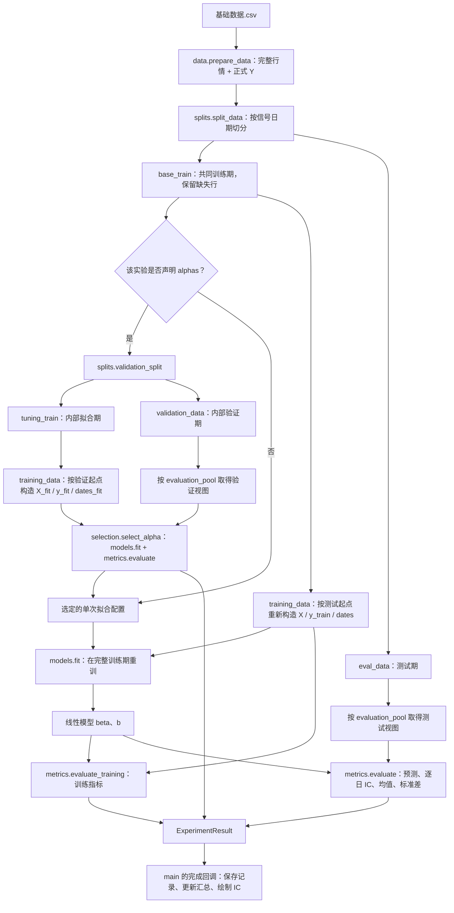

# 股票截面线性模型实验：项目架构与数据流

本项目从逐股行情构造正式标签 `Y`，在指定历史区间训练线性模型，并以测试期每日截面的 Pearson IC 比较实验。实验可以改变输入特征、训练样本、训练标签、损失函数和正则化方式；共同的数据准备、时间边界、参数选择与结果保存由同一条流程管理。

**本 README 说明代码如何协作；填写实验参数请看最新版 [manual.md](manual.md)。** 当前运行哪些实验，以 [config.py](config.py) 的 `EXPERIMENTS` 为准。

| 你要做什么 | 从哪里开始 |
| --- | --- |
| 配置并运行一个实验 | [manual：Quick Start](manual.md#1-quick-start) |
| 查字段含义、默认值和可选项 | [必填参数](manual.md#2-必填参数)、[选填参数](manual.md#3-选填参数) |
| 确认损失、惩罚、求解器能否组合 | [参数联动](manual.md#4-参数联动) |
| 复制三特征、填补、正则化或新损失示例 | [代表性示例](manual.md#5-代表性示例) |
| 排查配置和结果解读问题 | [常见误区](manual.md#6-common-pitfalls常见误区) |
| 理解数据流、依赖关系或扩展代码 | 继续阅读本文 |

## 1. 目录与运行入口

以下路径以项目根目录为基准；本文位于 `analysis/README.md`。

```text
proj1/
├── 基础数据/
│   ├── 基础数据.csv          # 主流程的原始输入
│   └── test.py               # 独立行情绘图脚本
├── analysis/
│   ├── README.md             # 架构、数据流与开发导航
│   ├── manual.md             # 实验配置手册
│   ├── config.py             # 路径、特征、时间窗口、实验声明
│   ├── analysis.py           # 主入口与实验编排
│   ├── data.py               # 读行情、计算正式 Y、基础清洗
│   ├── splits.py             # 外层训练/测试与内部拟合/验证切分
│   ├── training_data.py      # 按实验构造训练数据并转换为数组
│   ├── models.py             # 线性预测、损失、惩罚与求解器
│   ├── selection.py          # 根据验证 IC 选择 alpha
│   ├── metrics.py            # 训练指标、逐日 IC 与 IC 绘图
│   ├── results.py            # 保存、恢复、校验与汇总结果
│   ├── result_fingerprint.py # 计算每项实验所依赖代码的指纹
│   ├── __init__.py           # 包入口，仅导出配置
│   ├── results/             # 每项实验的完整记录和汇总
│   ├── train_data.pkl       # 共同训练期的绘图数据
│   └── alpha_search_results.csv
└── output/pdf/              # 报告构建脚本、报告与引用的结果快照
```

主流程使用 NumPy、pandas 和 Matplotlib。已有本地 `.venv` 时，从项目根目录运行：

```powershell
.\.venv\Scripts\python.exe -m analysis.analysis
```

也支持 `.\.venv\Scripts\python.exe analysis\analysis.py`。两种入口都调用 `main()`，读取 `config.py`，运行当前实验列表并保存结果。输入和默认输出路径相对于代码文件定位。

`基础数据/test.py`、历史备份和 `output/pdf/` 下的报告脚本不参与主入口执行。报告脚本主要消费实验结果或结果快照，必要时另行读取行情核对样本；生成报告与训练实验是两个独立入口。

## 2. 数据如何流转

### 2.1 从原始行情到一次实验结果

下图是**需要计算的实验**走的数据流；缓存命中时的路径见第 6 节。



`analysis.py` 负责图中各步骤的连接：`main()` 准备共享数据，`run_experiments()` 遍历配置，`run_experiment()` 完成一项实验。只要待运行实验中存在 `alphas`，整组就共享一次内部日期切分；每项实验仍独立构造自己的训练目标和训练样本。

`alphas` 省略或为 `None` 时，直接使用固定 `alpha` 重训，`validation_ic` 为 NaN。`alphas=[0.0]` 也走验证分支，只评价一个候选；多个候选以验证日均 IC 最大者胜出，同分保留输入顺序中的首项。搜索只返回选定配置和搜索表，最终模型必须在完整训练期重新拟合。程序不会跨实验自动选出最终方法。

### 2.2 数据形态与两个标签

| 数据形态 | 产生位置 | 保留什么、交给谁 |
| --- | --- | --- |
| 共同行情表 `data` | `data.prepare_data()` | 原始列、正式 `Y`、未来价格及对应日期；交给时间切分层，暂不清洗 |
| 时间区间表 `base_train` / `tuning_train` / 评价表 | `splits.py` | 按信号日期划分，保留计算上下文；训练副本交给 `training_data.py`，评价表按评价池取得视图 |
| 实验训练表 `train_data` | `prepare_training_data()` | 当前实验筛选、填补、清洗后的行，含 `Y_train`；随后提取数组 |
| 数值数组 `X`、`y_train`、`dates` | `as_training_arrays()` 与编排层 | `X` 为 `(样本数, 特征数)`，其余逐行对应；交给求解器和训练指标函数 |

**正式 `Y` 是评价标准，`Y_train` 是本次拟合目标。** `raw` 令二者相同；`daily_zscore` 在当前拟合期按日标准化有效 `Y`，生成另一列 `Y_train`。验证和测试始终用正式 `Y`，不跟随训练目标改变。

正式标签目前为 `第 5 个后续市场交易日收盘价 / 次日开盘价 / 5`，不减 1。`data.py` 先在完整行情上建立全市场交易日历，再按股票和精确日期连接价格；某只股票缺少对应价格时标签为空，不用该股票的“后面第 5 行”替代。

### 2.3 每次拟合都重新经过同一条训练数据流水线

```text
当前拟合期的副本
  → 检查信号日期，并屏蔽日期达到或超过 cutoff 的已连接未来值
  → make_training_target：计算 Y_train
  → make_selection_flag：计算 selected，再保留 selected=True 的行
  → 将所选输入、Y、Y_train 的非有限数转为 NaN
  → 按 train_feature_fill 填补指定输入
  → 按日期、实际输入、Y、Y_train 清洗
  → 按 feature_columns 顺序提取 X、y_train，并提取对应 dates
```

| 阶段 | 当前拟合期（默认） | cutoff | 评价数据（默认） |
| --- | --- | --- | --- |
| 内部验证选 alpha | 2012–2017 年 | `validation_start = 2018-01-01` | 2018 年训练期内的验证数据 |
| 最终重训 | 2012–2018 年完整训练期 | `test_start = 2019-01-01` | 2019–2020 年测试数据 |

时间窗口由 `SPLIT_CONFIG` 统一声明。外层信号日期范围包含起止日，训练标签的结束日期必须**严格早于**对应 cutoff。

这一顺序有具体作用：

- **保留目标计算的上下文。** 特征缺失的股票仍可能参与当日标签均值、标准差等参考统计，所以不能读入 CSV 后立即对整表 `dropna()`。日标准化先于特征清洗，最终训练子样本不保证仍然均值为 0、方差为 1。
- **隔离验证与测试信息。** 外层切分先将越过测试起点的训练 `Y` 置空；每次训练准备再按本次 cutoff 屏蔽 `Y`、第 5 日收盘价和次日开盘价。内部拟合不能复用在完整训练期上提前算好的 `Y_train`。
- **保持实验间独立。** 目标、样本筛选、填补都在副本上进行，某个实验扩大样本或填 0 不会修改其他实验的共同输入。

验证与测试有单独的清洗路径：`_evaluation_view()` 决定传哪些列，`metrics.evaluate()` 对传入视图执行缺失检查。默认 `common_5f` 传入完整评价表，辅助列缺失也可能删行；`selected_features` 只传股票代码、日期、所选输入和正式 `Y`。训练填补不应用于评价数据。完整规则见 [manual：参数联动](manual.md#4-参数联动)。

## 3. 模块职责与依赖关系

### 3.1 每个文件管理哪条边界

| 模块 | 核心接口与职责 | 边界 |
| --- | --- | --- |
| [config.py](config.py) | `EXPERIMENTS`、`SPLIT_CONFIG`；`get_training_config()`、`get_model_config()` 提取配置 | 声明参数，不读取行情或拟合 |
| [data.py](data.py) | `prepare_data()`、`calculate_y()`、`clean_data()` | 定义共同正式标签与基础清洗工具，不决定单项实验样本 |
| [splits.py](splits.py) | `split_data()`、`validation_split()` | 管理时间区间与外层标签边界，不构造实验目标或提前删缺失行 |
| [training_data.py](training_data.py) | `prepare_training_data()`、`as_training_arrays()` | 管理本次拟合的数据语义、样本和数组顺序，不修改评价池 |
| [models.py](models.py) | `fit()`、`predict()`、损失/惩罚与各求解函数 | 数组进，`(beta, b)` 出；不理解行情列名、路径和训练/测试划分 |
| [selection.py](selection.py) | `select_alpha()` | 在已准备好的拟合数组上搜索 alpha，不重新构造目标或切时间 |
| [metrics.py](metrics.py) | `evaluate_training()`、`evaluate()`、`plot_daily_ic()` | 计算指标和绘图，不拟合或选择参数 |
| [analysis.py](analysis.py) | `main()`、`run_experiments()`、`run_experiment()`、结果容器 | 连接配置、数据、模型和输出，不实现数值求解算法 |
| [results.py](results.py) | `build_context()`、`load_completed_result()`、`save_result()`、`export_summary()`、`save_ic_plot()` | 保存与恢复结果，调用绘图；不参与模型训练 |
| [result_fingerprint.py](result_fingerprint.py) | `source_snapshot()`、`experiment_code_hash()` | 静态读取源码并生成依赖指纹，不执行被分析代码 |
| [__init__.py](__init__.py) | 导出配置常量 | 导入包不会启动实验 |

配置也按边界传递：`sample_rule`、`target`、`train_feature_fill` 进入训练数据层；`loss`、`penalty`、单个 `alpha`、`solver` 及相应迭代参数进入模型层；候选 `alphas` 单独交给搜索层。编排层管理 `feature_columns` 和 `evaluation_pool`。求解器不接收整份实验声明，也不会根据列名自行改变样本。

### 3.2 实际的项目内依赖

下面表示“左侧模块导入或调用右侧模块”，不是数据流的先后顺序；省略标准库和第三方库。

```text
analysis.py       → config, data, splits, training_data,
                    selection, models, metrics, results
training_data.py  → config, data
selection.py      → models, metrics
metrics.py        → data, models
results.py        → config, result_fingerprint
                 → metrics（仅在 save_ic_plot 内导入绘图函数）
__init__.py       → config

config.py / data.py / splits.py / models.py / result_fingerprint.py
                 → 无项目内模块导入
```

`models.py` 只依赖 NumPy，数据表主要由 pandas 处理，IC 图片由 Matplotlib 绘制。主流程不依赖报告构建所用的 ReportLab、pypdf。

`result_fingerprint.py` 还会**读取**计算模块和编排代码的源文件，跟踪所用分支、函数及全局量。这属于缓存标识的数据来源，不是反向导入；`results.py` 也通过调用方传入的结果类型恢复对象，无需导入 `analysis.py`，因此这里没有循环导入。

## 4. 为什么拆分，而不是把所有逻辑放进 analysis.py

拆分依据是**数据状态和变化原因**。入口保留整个实验的可读顺序，各模块承担独立变化的部分。

| 边界 | 为什么单独存在 | 修改时的收益 |
| --- | --- | --- |
| 共同行情 / 时间切分 / 实验训练数据 | 同一行可能暂时不能训练，但仍是目标计算所需上下文；不同拟合阶段的 cutoff 也不同 | 更换目标或样本规则时，能明确检查是否在正确时间边界内计算，而不会顺手改变测试集 |
| 数据表 / 数值数组 | 日期、列名、缺失值是数据准备的问题；优化算法处理数值输入 | 新增求解器时只需实现统一数组接口，可用小型数组独立验证数学行为 |
| 参数搜索 / 单次拟合 / 指标评价 | 搜索要重复拟合并比较同一验证标准，最终又要完整重训 | OLS、Ridge、MAE 等方法共享验证与评价逻辑，避免每种方法复制一套时间切分 |
| 计算 / 输出与缓存 | 打印、CSV、图表、恢复记录的生命周期不同于模型计算 | 可在其他脚本中复用计算；缺图可由保存的 IC 补画；后续实验失败不丢失已完成结果 |
| 配置声明 / 流程实现 | 多数研究变动只是参数和组合发生变化 | 已有能力的新组合只追加配置，避免在主流程里不断添加实验专用分支 |

例如，比较 `raw` 与 `daily_zscore` 主要改变训练标签构造；比较 OLS 与 Ridge 主要改变求解配置；比较三特征与五特征还可能改变训练行数。明确这些边界后，可以分别设计对照，而不把标签变化、样本变化和算法变化混在一次修改里。

单文件可以运行同样的数学流程，但所有数据副本、截止边界、配置分派、文件读写都会集中在一起，新增实验时更难确认影响范围。当前拆分保留函数式接口和统一入口，没有为每项实验建立一套独立脚本。它仍有少量跨职责接口，例如 `metrics.py` 同时负责指标与 IC 图；实际边界以上面的依赖表为准。

## 5. 计算接口与返回结果

| 接口 | 调用方提供 | 返回结果 / 副作用 |
| --- | --- | --- |
| `prepare_data(data_path)` | CSV 路径 | 全量带正式 `Y` 的 DataFrame |
| `split_data(data, ...)` | 完整行情与外层时间窗口 | `base_train, eval_data` |
| `prepare_training_data(base_train, training_config, cutoff=..., feature_columns=...)` | 本次拟合期、训练配置、截止日期、输入顺序 | 已筛选清洗的实验训练表 |
| `models.fit(X, y_train, model_config, dates=...)` | 数组与单次拟合配置；按日求解必须有对应日期 | `(beta, b)`，预测为 `X @ beta + b` |
| `selection.select_alpha(...)` | 内部拟合数组、验证表、模型配置、候选 alpha、输入顺序与日期 | 选定模型配置、搜索明细表 |
| `metrics.evaluate(model, eval_data, feature_columns)` | 模型与评价视图 | 带预测的表、逐日 IC、IC 均值和样本标准差 |
| `run_experiment(...)` | 一项配置及所需时间区间表 | `ExperimentResult`；不打印、不写文件 |
| `run_experiments(...)` | 共同训练/测试表与实验列表 | `ExperimentRun`；默认不打印、不写文件，可传 `on_result(config, result)` |
| `main(results_dir=None, force=False)` | 可选输出目录与重跑开关 | 执行缓存、计算、打印和导出，返回 `(summary, models, daily_ics)` |

`ExperimentResult` 保存选定配置、模型、指标、逐日 IC 和搜索表，不保留完整逐股预测表。`ExperimentRun` 汇总各实验结果，并保存模型字典、逐日 IC 字典、搜索汇总和内部切分参考行数；参考行数是筛选清洗前的行数，不是每项实验的 `n_train`。

需要在其他脚本中复用计算时，可从项目根目录环境导入：

```python
from analysis.analysis import run_experiments
from analysis.config import DATA_PATH, EXPERIMENTS, SPLIT_CONFIG
from analysis.data import prepare_data
from analysis.splits import split_data

data = prepare_data(DATA_PATH)
base_train, eval_data = split_data(
    data,
    train_start=SPLIT_CONFIG["train_start"],
    train_end=SPLIT_CONFIG["train_end"],
    test_start=SPLIT_CONFIG["test_start"],
    test_end=SPLIT_CONFIG["test_end"],
)
run = run_experiments(
    base_train, eval_data, EXPERIMENTS,
    validation_start=SPLIT_CONFIG["validation_start"],
    test_start=SPLIT_CONFIG["test_start"],
)
print(run.summary)
```

这段代码直接计算，不经过 `main()` 的结果缓存和文件导出。

## 6. 结果保存、缓存与再次运行

`main()` 先逐项查询完成记录，再决定是否需要读取大 CSV：

1. 用数据文件绝对路径、大小、纳秒修改时间、时间窗口、特征顺序、NumPy/pandas 版本建立公共上下文。
2. 加上单项实验配置和所用计算代码的指纹，生成实验编号并校验记录。
3. 全部命中则恢复结果，跳过 CSV 解析、标签计算和拟合；部分命中则只准备一次共享数据，运行未完成项。
4. 每项完成后，通过回调立即保存完整记录、更新汇总并绘图。后续项失败时，已完成项可在下次复用。
5. 按当前 `EXPERIMENTS` 顺序合并结果；旧配置目录保留，但不混入当前汇总。

```text
analysis/results/
├── summary.csv
└── <实验名_编号>/
    ├── result.json       # 完整配置、上下文、系数、指标、IC、搜索表与完成时间
    ├── daily_ic.csv      # 测试期逐日 IC
    ├── daily_ic.png      # 测试 IC、20 条记录滚动均值及年度均值
    └── alpha_search.csv  # 内部验证明细；未声明 alphas 时为空
```

`result.json` 是恢复对象的依据，并最后写入作为完成标记；CSV 供查看且参与完整性校验。记录缺失、损坏或不匹配时重新计算。图片独立于数值缓存：缺图可用已保存的逐日 IC 补画，改变图形样式不会使数值结果失效；要刷新已有图片，可删除对应 PNG 后再运行入口。

`analysis/train_data.pkl` 是共同训练期按绘图字段独立清洗的导出，**不是每项实验筛选或填补后的实际训练表**。缓存全命中时不会重新生成它。`analysis/alpha_search_results.csv` 在有验证明细时导出；当前列表没有验证时，不会写入或清空已有文件。

新增实验不会仅因整个列表变化而重跑其他实验。修改已使用的计算分支、共享接口或评价逻辑会使相关缓存失效；静态分析无法确定的路径会保守纳入指纹。不要将缓存兼容性理解为任意代码修改都只影响一个实验。旧版 v1 记录的迁移入口在 `results.py`，只有代码与文件校验匹配时才复用。

```powershell
# 忽略已有结果，重跑当前列表
.\.venv\Scripts\python.exe -m analysis.analysis --force

# 指定完整实验记录的输出目录
.\.venv\Scripts\python.exe -m analysis.analysis --results-dir analysis\results_trial
```

`--results-dir` 只改变完整结果目录，训练 pickle 和合并搜索 CSV 仍由 `config.py` 中各自的路径控制。原始 CSV 采用文件元数据检测变化，不计算全文哈希；若修改内容同时保留大小和修改时间，应使用 `--force`。

## 7. 修改或扩展功能时从哪里入手

| 需求 | 修改位置 | 需要一起核对的约定 |
| --- | --- | --- |
| 新增已有能力的实验组合 | `config.py` 的 `EXPERIMENTS` | 按 [manual.md](manual.md) 填字段，名称唯一，固定可比较的评价口径 |
| 修改训练/验证/测试窗口 | `config.py` 的 `SPLIT_CONFIG` | 训练与测试不重叠，内部拟合和验证都有数据 |
| 新训练目标或样本规则 | `training_data.py` | 在筛选清洗前计算；新增未来窗口必须自行遵守 cutoff，不能依赖通用屏蔽自动识别任意公式 |
| 新损失、惩罚或求解器 | `models.py`，必要时更新配置提取与 `metrics.py` | 统一数组接口；实现真正匹配的求解算法，不能只修改报告用的 `objective()` |
| 改参数选择准则 | `selection.py` | 只使用内部验证数据；最终仍在完整训练期重训 |
| 改正式标签或评价标准 | `data.py` / `metrics.py` | 这是共同实验口径的变化，应重新审视各实验可比性与缓存失效范围 |
| 新评价池 | `analysis.py` 的 `_evaluation_view()` | 验证与测试使用相同列视图，不混入训练填补逻辑 |
| 改结果字段、文件或缓存规则 | `results.py` / `result_fingerprint.py` | 保存与恢复一致，完成标记与依赖指纹正确 |
| 改 IC 图样式 | `metrics.py` 的 `plot_daily_ic()` | 从保存的 IC 重绘即可 |

新增配置项或可选值时同步更新 `manual.md`；模块边界或数据流改变时更新本 README。实验结果和研究结论放在结果文件与报告中。

修改计算逻辑时，优先用小型合成数据检查 cutoff、目标/清洗顺序、数组日期对齐、数值结果和保存恢复。当前工作区没有 `analysis/tests/`，因此这里不提供指向该目录的测试命令；`基础数据/test.py` 是行情绘图脚本，不能代替回归测试。
